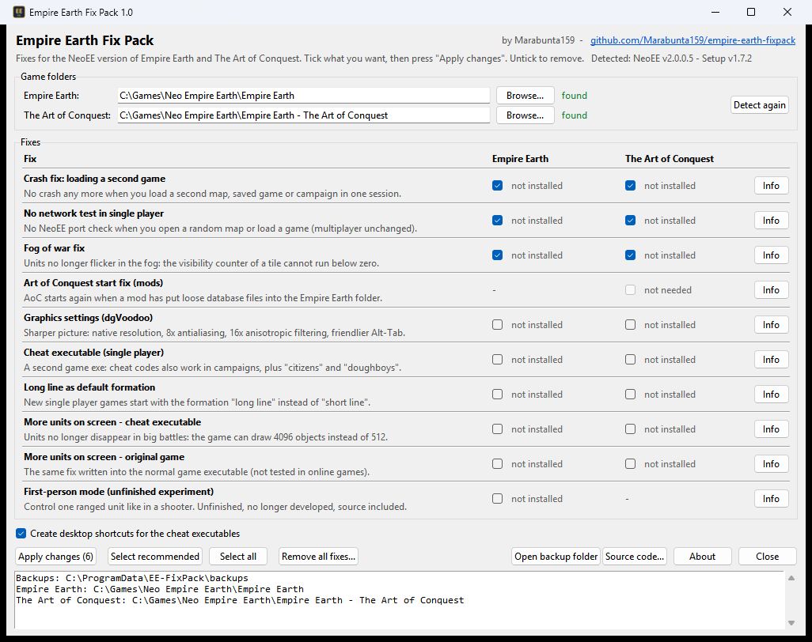

# Empire Earth Fix Pack (NeoEE)

Fixes and small mods for the **NeoEE** version of *Empire Earth* and *The Art of Conquest* - installed and
removed with one small program.

## Download

Get `EE-FixPack.exe` from the [Releases](../../releases) page, close the game and start it. It finds both games
by itself (or choose the folder with "Browse..."), you tick what you want - separately for Empire Earth and The
Art of Conquest - and press "Apply changes". To remove something, start it again and untick it.

No game files are included; the program patches your own installation, keeps backups
(`C:\ProgramData\EE-FixPack\backups`) and leaves files it does not recognise alone.

## What is in it

| Entry | What it does | Changes |
|---|---|---|
| Crash fix: loading a second game | No crash any more when a second map, saved game or campaign is loaded in one session | `Low-Level Engine.dll` |
| No network test in single player | No NeoEE port check for random maps / loading a game; multiplayer hosting unchanged | `TCP Protocol.dll` |
| Fog of war fix | The visibility counter of a tile cannot run below zero (units flickering in the fog) | `Low-Level Engine.dll` |
| Art of Conquest start fix | AoC starts again when a mod put loose db files into the Empire Earth folder | copies in `AoC\Data\db` |
| Graphics settings (dgVoodoo) | Native resolution, 8x antialiasing, 16x anisotropic filtering, no "always on top" | `dgVoodoo.conf` |
| Cheat executable | Second exe: cheat codes also in campaigns, new codes `citizens [1-50]`, `doughboys [1-50]`; single player only | `EE-Cheats.exe`, `EE-AOC-Cheats.exe` (new) |
| Long line as default formation | New single player games start with "long line" instead of "short line" | cheat executable |
| More units on screen | The game draws at most 512 objects per frame - units disappear in big battles. Raised to 4096 | cheat executable or original executable |
| First-person mode | Control one ranged unit like in a shooter. **Unfinished experiment, no longer developed** - continue it if you like | `ee_fps.dll` (Empire Earth only) |

Tested with NeoEE v2.0.0.5 (Setup v1.7.2) on Windows 11.

## How the fixes work (short)

- **Units disappear:** every frame the game collects the objects in view in a fixed table of 512 entries
  (`cmp [count], 0x200 / jae skip`). The patch moves the two tables into new memory behind the last section of
  the executable and raises the limits (4096 / 8192). Display only.
- **Second load crashes:** the engine maps the whole 160 MB archive again for every load; in the fragmented
  2 GB address space the mapping fails and the next read goes through a null pointer. The patch maps one file
  at a time.
- **Network test:** NeoEE hooks the socket bind of every session; the patch looks at the "local session" flag
  first and lets single player sessions bind the port the original way.
- **AoC does not start:** AoC also reads the base game's data folder, so a loose EE-format `dbtechtree.dat`
  of a mod wins against AoC's own file. The fix puts AoC's own versions into its own folder.
- **Default formation:** at the end of the human player constructor the game does what the "long line" button
  does (single player only, computer players untouched).

Every patcher finds its places by signature, refuses unknown files, writes a patch record next to the file
and can undo exactly its own bytes. Details of the investigation (German, chronological): `docs/MODLOG.de.md`.

## Source layout

| Path | Content |
|---|---|
| `fixpack/ee_fixpack.py` | the GUI (tkinter); `python fixpack/ee_fixpack.py` runs it without building |
| `fixpack/build_exe.py` | builds `EE-FixPack.exe` (`pip install pyinstaller pillow`) |
| `crashfix/`, `net/`, `fogfix/`, `aoc/`, `cheat/`, `unitcap/`, `formation/` | one patcher per fix; each also works alone: `python <file> status\|install\|uninstall` |
| `fps/` | first-person mode: `src/ee_fps.cpp` (32 bit, MSVC, `src/build.cmd`), built `ee_fps.dll`, ini files |
| `ee_fixes.py`, `install_ee_fixes.cmd` | command line installer (German) |
| `dev/` | test helpers: start an unelevated copy of the game and drive it in-process with Frida |
| `samurai-mod/` | an older data mod (Samurai for Empire Earth) and the `.dat` tools used for it |

The GUI has a small command line for unattended use and tests:
`--ee DIR --aoc DIR --select all|none|recommended|crash,net:ee,... --apply --report file.json --exit`.

## Notes

- The executable is not signed; Windows SmartScreen may warn. Build it yourself from this source if you prefer.
- "More units on screen - original game" has not been tested in NeoEE online games.
- Very large armies cost frame rate (measured at 2560x1440: 650 units in view 100 fps, 2000 units 24 fps).
